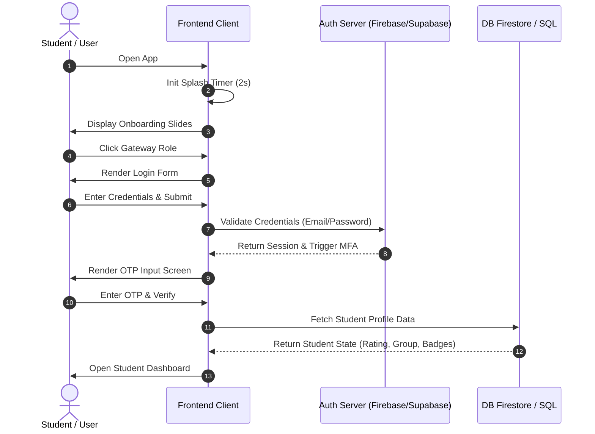

# EliteHire Mobile Application: Full-Stack Line of Execution

This document maps out the end-to-end user journeys in the EliteHire mobile application, detailing the frontend interactions, matching backend API/Database operations, and Stitch screen reference identifiers.

---

## Part 1: Gateway & Authentication Journey

### 1. Application Initialization & Onboarding
- **Frontend Action**: The user launches the mobile app. A splash screen renders for `2000ms`, then redirects to a 3-part onboarding slide details carousel explaining platform features.
- **Backend Operation**: The client fetches the remote config parameters (branding themes, network endpoints) and checks if a valid session token exists in local storage.
- **Stitch Screen Reference**: 
  - Splash: `mobile_ad4fdcc896ba4b529a55fae35d3be56e_Liquid_Glass_Splash_Screen.html`
  - Onboarding: `mobile_25a53d38e1b34f3f97656813e6fb0cb1_Onboarding_Carousel_COM-02.html`

### 2. Role Selection
- **Frontend Action**: The user selects their entry role (Student, Recruiter, Admin).
- **Backend Operation**: Sets the client routing context variable `userRole` to load the appropriate login options.
- **Stitch Screen Reference**: `mobile_ed5135a3e3674964b190166cbcbf1113_Role_Selection_COM-03.html`

### 3. Student Registration / Sign Up
- **Frontend Action**: New student inputs full name, email, credentials, and uploads verification documents (University ID card).
- **Backend Operation**: Registers credentials in the Authentication server, uploads the ID image asset to the storage bucket, and appends a pending profile document to the database `students` collection.
- **Stitch Screen Reference**: `mobile_1a076025461a4dc4bad866ed6d98bb3b_Student_Registration_COM-05.html`

### 4. Secure Login & MFA Verification
- **Frontend Action**: The user enters their university email and password, then inputs the 4-digit OTP code sent to their registered device.
- **Backend Operation**: The Auth server validates credentials, generates a time-based OTP passcode via SMS/Email templates, validates the code, and creates an active secure token session.
- **Stitch Screen Reference**: 
  - Login: `mobile_73c01c0c980a45af8f3fe8eac02040d2_Login_Screen_COM-04.html`
  - MFA: `mobile_3f182e61b905473294e58ff1bc99f585_Account_Security_MFA_-_Mobile.html`

---

## Part 2: Student Learning & Assessments Journey

### 5. Student Dashboard (Weekly Tests Hub)
- **Frontend Action**: Renders user progress metrics (overall rating stars, identity trust score, accumulated badges) and displays navigation cards for catalog modules.
- **Backend Operation**: Queries database collections matching student groups to fetch scheduled tests, upcoming assignments, and recommended courses.
- **Stitch Screen Reference**: `mobile_f6816511fb8a498b9f32199700db9876_Weekly_Tests_Hub.html`

### 6. Proctor Verification & Test Launcher
- **Frontend Action**: The user selects "Start Secure Assessment". The app displays proctor guidelines and verifies camera hardware access permissions.
- **Backend Operation**: The client initializes camera hardware streams, registers the test state with the database, and begins proctor session monitoring.
- **Stitch Screen Reference**: `mobile_1f162cf8bbc34279b557f56cffecaedc_Test_Entry_&_Guidelines.html`

### 7. Timed Proctor Examination (Anti-Cheat Player)
- **Frontend Action**: The student answers multiple-choice questions while keeping their face centered in the proctor video frame.
- **Backend Operation**: 
  - The client monitors browser focal state: `blur` events (tab-swapping) trigger immediate alerts and deduct points from the student's `trustScore` in the database.
  - Webcam biometric feeds are evaluated.
  - Submitting responses stops camera streams, saves the final score, and increments the student's `rating` and `badges` values inside the database.
- **Stitch Screen Reference**: `mobile_952d8a8184e24a54b99d386bb01670e0_Test_Player_Anti-Cheat_Mode.html`

### 8. Course Catalog & Playback
- **Frontend Action**: The student browses recommended skill modules and launches lecture chapters.
- **Backend Operation**: Queries the database `courses` catalog based on user test results, fetches video streams, and logs video playback milestones.
- **Stitch Screen Reference**: 
  - Catalog: `mobile_e9aa3c620d904e9eb0be5f06961a8c67_Course_Catalog_Screen_19.html`
  - Player: `mobile_98995f4834aa4c10a79ec28509e22d5a_Course_Detail_&_Video_Player.html`

### 9. Assignments Hub & Link Submissions
- **Frontend Action**: Selects assignments and enters project links (e.g. GitHub repos) or uploads source folders.
- **Backend Operation**: Adds submission metadata (timestamp, URLs) to the database, marking the status as "pending review" in the admin evaluation queues.
- **Stitch Screen Reference**: 
  - Generator/Hub: `mobile_4c34db15874749d18ab536bf7c7f1916_Assignment_Generator_ADM-05_-_iOS_Liquid_Glass.html`
  - Submit: `mobile_5d0bbe95388b480da4f3d751bbc8f21b_Assignment_Submission_Page.html`

---

## Part 3: Career Matching & Upgrades Journey

### 10. Profile CV Portfolio
- **Frontend Action**: Displays the student's career portfolio, verified assessment scores, badges, and project repositories.
- **Backend Operation**: Computes the student's percentile position in the national ranking databases.
- **Stitch Screen Reference**: `mobile_3fe92f24fd834bf38ce21ce947d29733_Student_Profile_CV_Portfolio.html`

### 11. Job Board Filtration & Applications
- **Frontend Action**: Filters recommended jobs/internships by competency parameters, views position specifications, and clicks "Apply".
- **Backend Operation**: Matches profile skill tags against the active jobs tables and checks premium membership validation flags.
- **Stitch Screen Reference**: 
  - Search: `mobile_7b107fe80c4845bfb0168fc817ca3f14_Search__Filters_JobsInternships.html`
  - Details: `mobile_1458ea7fb7a94fb29ef274a5d90a2b7f_Job_Details_-_Senior_UX_Designer.html`

### 12. Checkout & Premium Mentorship Hub
- **Frontend Action**: Enters payment credentials to upgrade to a Gold Elite tier subscription and views the premium portal dashboard.
- **Backend Operation**: Invokes the Stripe payment gateway module to complete checkout, updates the user's role status to `premium_student` in the database, and exposes senior engineer scheduler calendars.
- **Stitch Screen Reference**: 
  - Checkout: `mobile_a6e109f2933846aeb0e3ddc485644695_Checkout_&_Billing_-_iOS_Liquid_Glass.html`
  - Premium Hub: `mobile_50c3ba980c7445a9a2d621165a4f695d_Premium_Hub_-_Gold_Elite.html`
